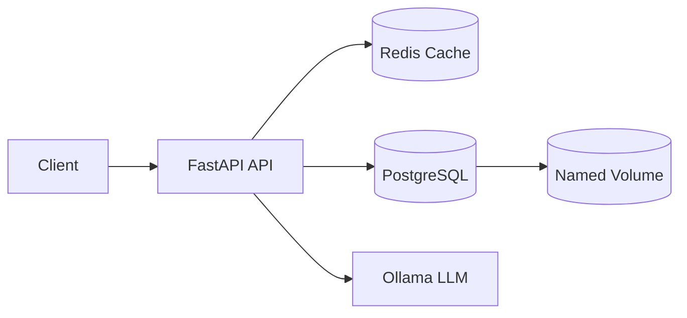

# LLM Question API

A FastAPI backend that accepts questions, retrieves cached answers from Redis, stores question-and-answer records in PostgreSQL, and generates new answers using a local Ollama model.

## Architecture



The application follows this request flow:

1. Normalize the submitted question.
2. Create a SHA-256 hash for the normalized question.
3. Check Redis for a cached answer.
4. If Redis misses or is unavailable, check PostgreSQL.
5. If PostgreSQL has no answer, call Ollama.
6. Store the generated answer in PostgreSQL.
7. Cache the answer in Redis with a TTL.
8. Return the answer and its source.

Redis failures do not stop the main workflow. The application logs a warning and continues using PostgreSQL and Ollama.

## Technology Stack

- Python 3.13
- FastAPI
- Ollama
- PostgreSQL
- SQLAlchemy
- Alembic
- Redis
- Docker and Docker Compose
- uv
- Pytest
- Ruff
- GitHub Actions
- Docker Hub

## API Endpoints

| Method | Endpoint | Purpose |
|---|---|---|
| `GET` | `/health` | Check API health |
| `POST` | `/ask` | Ask a question |
| `GET` | `/questions` | Read stored question history |
| `POST` | `/cache` | Store a demonstration cache value |
| `GET` | `/cache/{key}` | Read a demonstration cache value |
| `GET` | `/docs` | Open Swagger UI |

## Database Design

The `qa_records` table stores:

- UUID primary key
- Original question
- Normalized question
- SHA-256 question hash
- Answer
- Ollama model name
- Creation timestamp

A unique constraint on `question_hash` and `model_name` prevents the same normalized question from being stored more than once for the same model.

The question and answer are stored in one table because they have a one-to-one relationship and the same lifecycle. This avoids unnecessary joins and allows both values to be inserted atomically.

## Environment Setup

Copy the example environment file:

```powershell
Copy-Item .env.example .env
```

Edit `.env` and set a strong PostgreSQL password:

```dotenv
POSTGRES_PASSWORD=replace-with-a-strong-password
API_IMAGE=llm-question-api:1.0
CACHE_TTL_SECONDS=3600
```

Do not commit `.env`.

Make sure Ollama is running and the model is available:

```powershell
ollama list
ollama pull qwen2.5:3b
```

## Run with Docker Compose

Build and start the application:

```powershell
docker compose up -d --build
```

Docker Compose starts:

- `postgres`
- `redis`
- `migrate`
- `api`

The `migrate` service waits for PostgreSQL and runs:

```text
alembic upgrade head
```

The API is available at:

- Swagger: http://localhost:8000/docs
- Health: http://localhost:8000/health

View service status:

```powershell
docker compose ps -a
```

View API logs:

```powershell
docker compose logs api --tail 100
```

Stop the services without deleting data:

```powershell
docker compose down
```

Named volumes preserve PostgreSQL and Redis data. Running `docker compose down -v` also deletes those volumes and their data.

## Example Request

```powershell
$body = @{
    question = "What is Docker Compose?"
} | ConvertTo-Json

Invoke-RestMethod `
    -Uri "http://localhost:8000/ask" `
    -Method Post `
    -ContentType "application/json" `
    -Body $body |
    ConvertTo-Json
```

A new question returns:

```json
{
  "question": "What is Docker Compose?",
  "answer": "...",
  "model": "qwen2.5:3b",
  "source": "ollama"
}
```

Repeating the request should return:

```json
{
  "source": "cache"
}
```

After Redis expiration, PostgreSQL can provide the stored answer and warm the cache again.

## Testing

Install locked dependencies:

```powershell
uv sync --locked
```

Run lint checks:

```powershell
uv run ruff check app tests migrations
```

Run automated tests:

```powershell
uv run pytest -v
```

## Database Migrations

Apply all migrations inside the Compose network:

```powershell
docker compose run --rm api /app/.venv/bin/alembic upgrade head
```

Inspect the stored records:

```powershell
docker compose exec postgres `
    psql -U app_user -d app_db `
    -c "SELECT * FROM qa_records;"
```

## Docker Image

The production image uses a multi-stage Docker build. Dependencies are prepared in the builder stage and only the virtual environment and application files are copied into the runtime stage.

The runtime container runs as the non-root user `app` with UID `10001`.

Pull the published image:

```powershell
docker pull 
habibakhaled9/llm-question-api:latest
```

Run Compose using the published image:

```powershell
$env:API_IMAGE = "<dockerhub-username>/llm-question-api:latest"
docker compose pull api migrate
docker compose up -d --no-build
```

## CI/CD Pipeline

The GitHub Actions workflow runs on pull requests to `main`, pushes to `main`, release tags, and manual execution.

The pipeline:

1. Checks out the repository.
2. Installs Python and uv.
3. Runs Ruff.
4. Runs Pytest.
5. Logs in to Docker Hub.
6. Builds the multi-stage Docker image.
7. Pushes commit-SHA and release tags.
8. Pushes `latest` from the default branch.

Required GitHub configuration:

- Repository variable: `DOCKERHUB_USERNAME`
- Repository secret: `DOCKERHUB_TOKEN`

Creating a tag such as `v1.0.0` publishes a versioned Docker image.

## Git Workflow

Development moves through these branches:

```text
feature branch → development → testing → main
```

`main` represents the production-ready version.